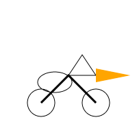
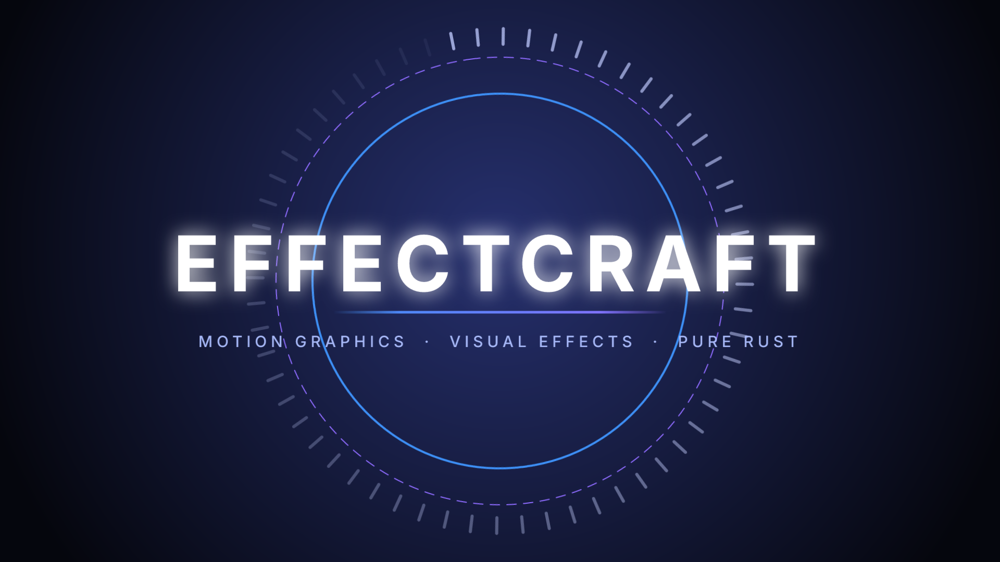

# democraft-mcp

Demo fleet for the ArtCraft family. One page per Craft app, every demo a real
headless CLI/MCP run plus a real local-LLM step. No fake pixels: account-gated
engine features return `needs_account`, missing wrappees return `wrappee_missing`.

  

## Preview

Same prompt ("pelican riding a bike" as AI-drafted SVG), two real pipelines:

| PhotoCraft (`convert` + `info`) | VectorCraft (`run` + `export`) |
|---|---|
|  |  |

Plus a real EffectCraft demo-project still (1920x1080):



Shapes are AI-drawn, pixels are engine-rendered - the compare page shows both
engine logs side by side.

## How it runs

Headless by default: each demo shells to the installed `<Craft>\*-cli.exe`
(`C:\Program Files\...`) and renders artifacts into `outbox/<app>/<demo>/`.
With an app open on its control port, the same demos can drive the live app
(`--connect`); the API reports which path ran. Hands-in: run any demo from the
webapp or chat and inspect real outputs. Hands-out: demos never modify your
Craft documents - they work in `outbox/` only.

## Quickstart

1. Install the Craft apps (see `docs/ONBOARDING.md` - wrappees are the product).
2. Double-click `start.bat` (backend :11246, frontend :11245).
3. Open the Dashboard, pick a Craft page, run demo #1.

## Stack

Python 3.11+ (uv) - FastMCP 3.4.4+ - FastAPI + Pydantic v2 - Uvicorn -
prefab-ui. Webapp: React 19 - Vite 6 - TailwindCSS 4 - Lucide - Framer Motion -
Zustand - React Router - TypeScript - Biome - Playwright. Package managers:
uv (Python) + Bun (JS). Gates: `just ci` (ruff, pytest, pyright, tsc, biome, build).

## Tools

| Tool | Pattern | What |
|------|---------|------|
| `craft` | portmanteau (8 ops) | list_apps, app_status, run_demo, craft_commands, ollama_models, ai_flow, help, shutdown |
| `show_apps_prefab_card` | Prefab | Installed-apps card |
| `show_demo_prefab_card` | Prefab | Single-demo card |
| prompt `democraft_demo_guide` | prompt | Per-app demo instructions |
| resource `democraft://apps` | resource | Live registry JSON |

Full reference: `docs/TOOLS.md`.

## Env vars

| Var | Default |
|-----|---------|
| `DEMOCRAFT_PORT` | `11246` (frontend :11245) |
| `DEMOCRAFT_MODEL` | `gemma4:12b` |
| `DEMOCRAFT_OLLAMA_URL` | `http://127.0.0.1:11434` |
| `DEMOCRAFT_OUTBOX` | `<repo>/outbox` |
| `DEMOCRAFT_PROGRAM_FILES` | `C:\Program Files` |
| `DEMOCRAFT_PREFAB_APPS` | `1` (0 skips Prefab tools) |

## Documentation

| Doc | What |
|-----|------|
| `docs/ONBOARDING.md` | Wrappee install, AI model setup, first demo |
| `docs/CONFIGURATION.md` | Env vars, ports |
| `docs/DEVELOPMENT.md` | Dev loop, tests, CI |
| `docs/TOOLS.md` | `craft` operations reference |
| `docs/TROUBLESHOOTING.md` | Engine errors, Ollama down, missing wrappees |
| `INSTALL.md` | Naked-PC install |
| `CHANGELOG.md` | Releases |

## MCP config

```json
{ "mcpServers": { "democraft": { "command": "uv", "args": ["run", "python", "-m", "democraft_mcp.mcp_stdio"], "cwd": "D:\\Dev\\repos\\democraft-mcp" } } }
```
