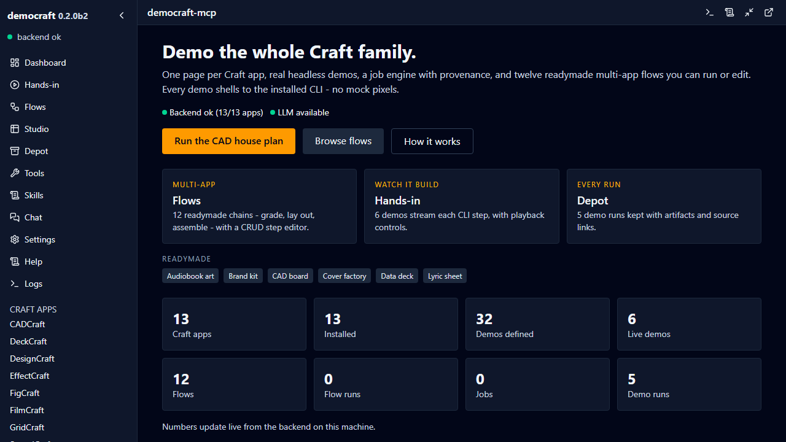
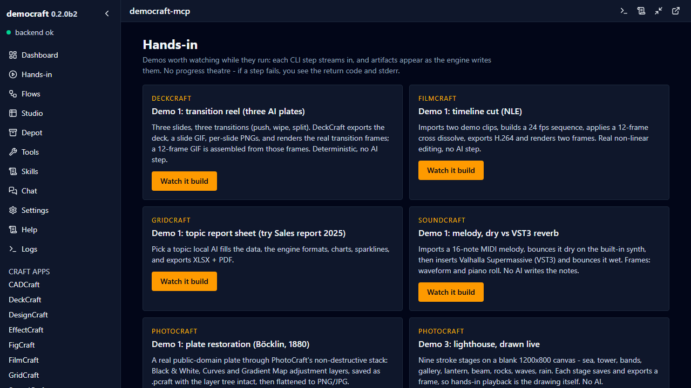
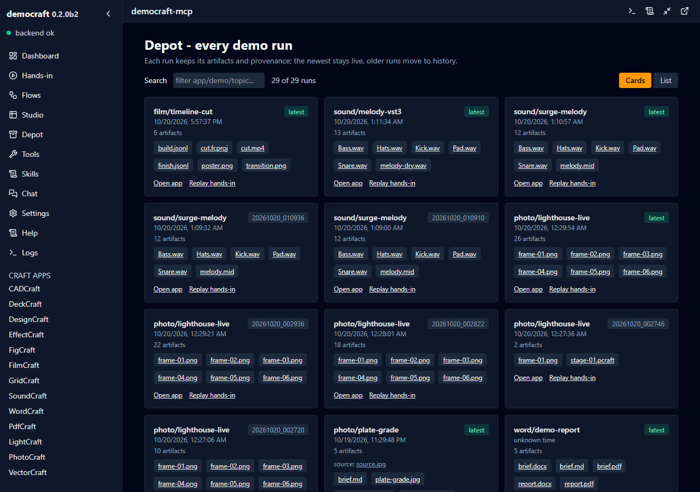

# democraft-mcp

  
  
  
  
  
  
  
  

**Watch the ArtCraft family build: 13 creative apps, 32 demos, real CLI output you can see and hear.**

Every demo drives an installed `<App>\<app>-cli.exe`, streams its steps while it runs, and
leaves the artifacts on disk with a manifest and the engine log beside them. No mock pixels,
no progress theatre.

## What this wraps

The **ArtCraft** family: thirteen local creative apps, each a desktop alternative to an
industry standard - CADCraft (AutoCAD), DeckCraft (PowerPoint), DesignCraft (InDesign),
EffectCraft (After Effects), FigCraft (Figma), FilmCraft (Premiere Pro), GridCraft (Excel),
SoundCraft (Ableton Live), WordCraft (Word), PdfCraft (Acrobat Pro), LightCraft (studio
lighting), PhotoCraft (Photoshop), VectorCraft (Illustrator).

Nothing is bundled. Install the apps you care about from <https://getartcraft.com>; this repo
is the control surface and the demo bench. What each app is, and where it lives:
[docs/WRAPPEE.md](docs/WRAPPEE.md).

## Preview

| Dashboard | Hands-in: watch it build | Depot: every run kept |
|---|---|---|
|  |  |  |

*Our webapp (:11245), not the Craft apps' native UIs: one page per engine, live steps, and the
run history the engines do not keep for you.*

## What You Can Do

**How it runs**: headless by default. Each demo shells to the installed CLI and writes into
`outbox/<app>/<demo>/`. Tick **Watch it build** and the same run streams every step over SSE,
artifacts appearing as each step finishes; a failed step shows its return code and stderr
instead of a green tick. The Craft apps do not need to be open, and the demos never touch your
Craft documents.

| Direction | Artifacts | Notes |
|---|---|---|
| **Hands-in** | prompts, topics, demo footage, source plates, MIDI | typed in the webapp; MCP `run_demo` uses each demo's default prompt |
| **Hands-out** | DXF/PDF/SVG, DOCX, XLSX, PPTX+GIF, MP4, WAV, `.pcraft`, EDL, PNG/JPG | `outbox/<app>/<demo>/` with `run.json` and the engine log |

- **Watch a cut happen**: FilmCraft imports two clips, builds a 24 fps sequence, applies a
  12-frame cross dissolve, exports H.264 and renders the frame inside the dissolve.
- **Hear the difference**: SoundCraft bounces a 16-note MIDI melody dry on the built-in synth,
  then through Valhalla Supermassive and bounces it wet, with waveform and piano-roll frames.
- **Watch a drawing appear**: PhotoCraft draws a lighthouse in nine stroke stages; playback is
  the drawing itself.
- **Compare models honestly**: the pelican-on-a-bicycle benchmark, same prompt through
  PhotoCraft and VectorCraft. The ugliness is the measurement.
- **Keep every run**: each run gets a folder and a manifest; older runs move to `_history`
  instead of being overwritten.
- **Chain apps**: twelve readymade multi-app flows (cover factory, photo book, data deck,
  audiobook art, score-driven cut) that you can run, edit or reorder.
- **Local first**: AI steps use Ollama; if it is down the CLI half still runs and the AI step is
  marked skipped, never faked.

## The thirteen apps

| App | Local alternative to | Demos | Watch / listen | Details |
|---|---|---|---|---|
| CADCraft | AutoCAD / BricsCAD | 2 | - | [cad](docs/apps/cad.md) |
| DeckCraft | PowerPoint / Keynote | 3 | transition reel | [deck](docs/apps/deck.md) |
| DesignCraft | Adobe InDesign | 2 | - | [design](docs/apps/design.md) |
| EffectCraft | After Effects | 2 | - | [effect](docs/apps/effect.md) |
| FigCraft | Figma | 2 | - | [fig](docs/apps/fig.md) |
| FilmCraft | Premiere Pro | 3 | timeline cut | [film](docs/apps/film.md) |
| GridCraft | Excel | 2 | topic report | [grid](docs/apps/grid.md) |
| SoundCraft | Ableton Live / Pro Tools | 3 | dry vs VST3 | [sound](docs/apps/sound.md) |
| WordCraft | Microsoft Word | 2 | - | [word](docs/apps/word.md) |
| PdfCraft | Acrobat Pro | 2 | - | [pdf](docs/apps/pdf.md) |
| LightCraft | studio lighting | 2 | - | [light](docs/apps/light.md) |
| PhotoCraft | Photoshop | 5 | plate grade, lighthouse | [photo](docs/apps/photo.md) |
| VectorCraft | Illustrator | 2 | - | [vector](docs/apps/vector.md) |

Full catalog and the demo contract: [docs/apps/README.md](docs/apps/README.md).

## Hands-in: see it, hear it

**Hands-in** is the page for demos worth watching. Six runs stream their CLI steps, and the
craft page replays them with Play / Pause / Stop / Rewind and a 0.25x-4x speed slider while
artifacts appear as they land.

Sound makes the point literally: the melody demo writes `melody_dry.wav` and
`melody_surge.wav`, so you hear the same notes with and without the reverb instead of reading
a claim about it. The lighthouse demo saves a frame per stroke, so playback is the drawing.

## Install

1. **Install the Craft apps** you want to demo from <https://getartcraft.com>. This repo ships
   no engines; a missing app returns `wrappee_missing` and its page shows a MOCK badge.
2. **Claude Desktop**: download `democraft-mcp.mcpb` from the
   [latest release](https://github.com/sandraschi/democraft-mcp/releases/latest) and open it.
   The bundle registers the MCP server only; it does not install the webapp.
3. **Webapp**: with uv and Node.js installed, run `start.bat`, then open
   <http://127.0.0.1:11245> (backend on :11246). There is no installer for the webapp yet.

Manual config, other clients and validation: [INSTALL.md](INSTALL.md).

## Example prompts

- "List the Craft apps installed here, then run the FilmCraft timeline cut and show me the
  transition frame."
- "Run the SoundCraft melody demo and compare the dry and reverb bounces."
- "Build a photo-book flow: grade the plate, lay out the spread, combine the PDF."

## Companions

| Companion | Role | Required? |
|---|---|---|
| ArtCraft apps | the engines every demo drives | yes, per app you demo |
| Ollama | local AI steps (topics, briefs, notes) | optional - the CLI half still runs |
| GridCraft web build | embedded in `/studio` via `scripts/fetch-gridcraft-web.ps1` | optional |

## Documentation

| Doc | Contents |
|---|---|
| [INSTALL.md](INSTALL.md) | All install paths, MCP config, validation |
| [docs/ONBOARDING.md](docs/ONBOARDING.md) | Install the apps, pick a model, first demo |
| [docs/WRAPPEE.md](docs/WRAPPEE.md) | What ArtCraft is, app by app |
| [docs/apps/](docs/apps/README.md) | One page per Craft app: demos, artifacts, gaps |
| [docs/TOOLS.md](docs/TOOLS.md) | `craft` operations, prompts, resources |
| [docs/CONFIGURATION.md](docs/CONFIGURATION.md) | Env vars and ports |
| [docs/DEVELOPMENT.md](docs/DEVELOPMENT.md) | Dev loop, tests, gates |
| [docs/TROUBLESHOOTING.md](docs/TROUBLESHOOTING.md) | Missing wrappee, Ollama down, engine stderr |
| [docs/FREE_VST3_SET.md](docs/FREE_VST3_SET.md) | Free VST3s used by the audio demos |
| [CHANGELOG.md](CHANGELOG.md) | Releases |

## Requirements

Windows 11 - the demos target the installed Windows CLIs. One or more Craft apps. Ollama with a
pulled model for the AI steps. Running the webapp from source needs uv, Node.js and Bun; see
[docs/DEVELOPMENT.md](docs/DEVELOPMENT.md).

## Licence

The code in this repo is (c) Sandra Schipal; no licence file is present yet, so ask before
redistributing. The Craft apps and their engines are licensed separately by ArtCraft.
