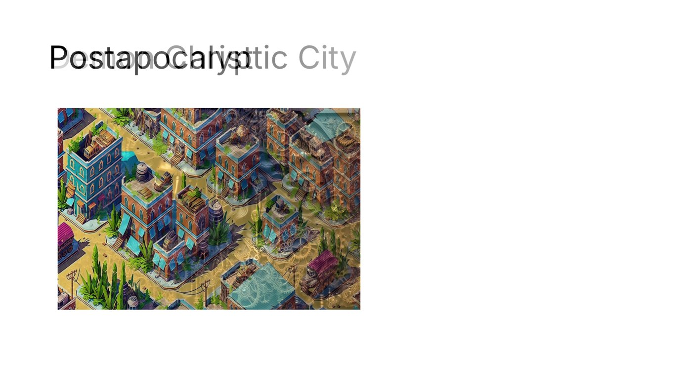

# DeckCraft demos

[All apps](README.md) | [Repo README](../../README.md)

**What it is**: slide decks rendered headless, with transitions and image export. The app's own
comparison is PowerPoint / Keynote. Driven by
`C:\Program Files\DeckCraft\deckcraft-cli.exe`.

## Demos

| Demo | What actually runs | Artifacts | AI step |
|---|---|---|---|
| `transition-reel` | Three slides with three transitions (push, wipe, split). The engine exports the deck, a slide GIF and per-slide PNGs, then renders the real transition frames; a 12-frame GIF is assembled from those frames. | deck, slide GIF, PNG frames, transition GIF | none - deterministic |
| `pitch-deck` | Renders the sample deck to PNGs; the local model outlines five slides for the chosen subject. | slide PNGs, `outline.md` | five-slide outline |
| `capability-map` | The installed CLI's `commands` output (or `--help`). | `capabilities.txt` | none |

`transition-reel` is flagged **live** - watch it build to see the frames appear one transition
at a time.

## Hands-in / Hands-out

| Direction | What |
|---|---|
| Hands-in | a subject for the pitch deck; the model writes the outline |
| Hands-out | rendered slides (PNG), the deck file, animated GIFs |



*Engine frame from the transition reel (wipe, t = 0.4). The slides are deck templates; the
transition frames are what the engine actually composited.*

## Run it

```
/craft/deck
/craft/deck?demo=transition-reel&watch=1
craft(operation="run_demo", app="deck", demo="transition-reel")
```

Artifacts: `outbox/deck/<demo>/`.

## Observed gaps

- No Office round-trip verified (`.pptx` import/export).
- No third-party template ecosystem.
