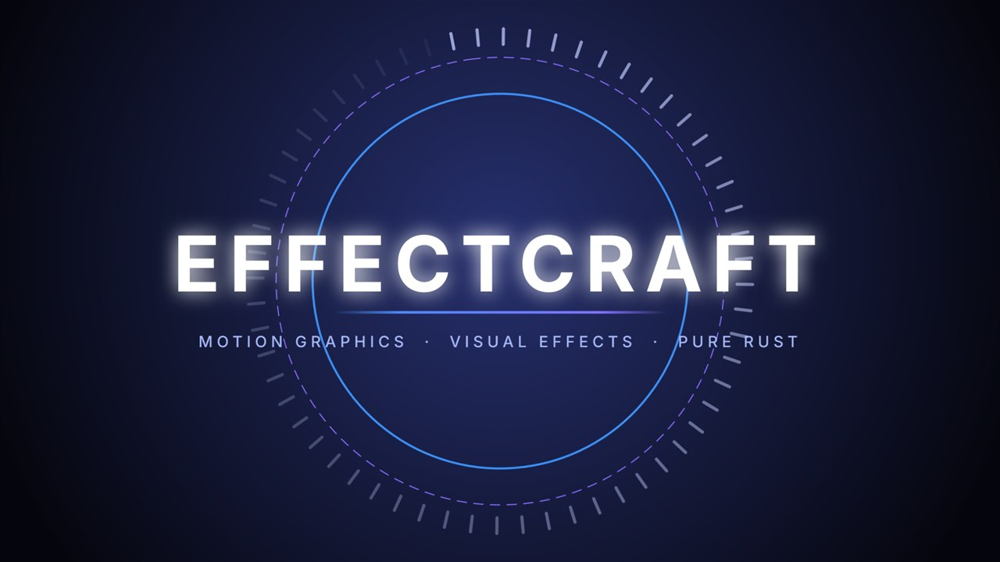

# EffectCraft demos

[All apps](README.md) | [Repo README](../../README.md)

**What it is**: motion-graphics projects - keyframes, expressions, cameras, audio - rendered
headless. The app's own comparison is Adobe After Effects. Driven by
`C:\Program Files\EffectCraft\effectcraft-cli.exe` (verified against 0.14.0).

## Demos

| Demo | What actually runs | Artifacts | AI step |
|---|---|---|---|
| `title-card` | Renders a still from the demo motion project; the local model writes a title-card spec for the chosen subject. | still PNG, `brief.md` | title text, palette and timing as JSON |
| `capability-map` | The installed CLI's `commands` output (or `--help`). | `capabilities.txt` | none |

Topic presets: Democraft title, Pelican reveal, Bakery morning, Night tram.

## Hands-in / Hands-out

| Direction | What |
|---|---|
| Hands-in | a subject; the model returns the title spec |
| Hands-out | rendered stills (PNG); the engine's own project/video renders where the build supports them |



*An EffectCraft still, rendered by the engine. The repo keeps one still per app where a single
frame is honest evidence of the output.*

## Run it

```
/craft/effect
/craft/effect?demo=title-card&watch=1
craft(operation="run_demo", app="effect", demo="title-card")
```

Artifacts: `outbox/effect/title-card/`.

## Observed gaps

- No particle system in the command catalog.
- No third-party plugin ecosystem.

## Release 0.14.0 notes

EffectCraft 0.14.0 introduces the color grading panel, color grading effect parameters, and rendering pipeline updates.

The demo renders a still, not a sequence. That is the scope of this demo - the title spec and
the still are what it verifies - not a claim that the engine cannot animate.
