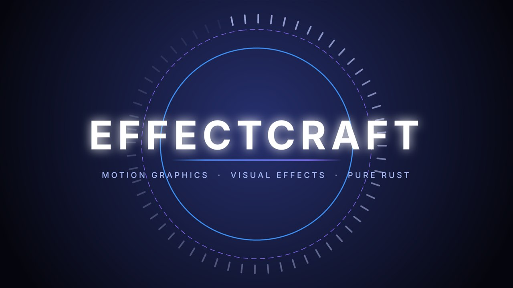

# EffectCraft demos

[All apps](README.md) | [Repo README](../../README.md)

**What it is**: motion-graphics projects - keyframes, expressions, cameras, audio - rendered
headless. The app's own comparison is Adobe After Effects. Driven by
`C:\Program Files\EffectCraft\effectcraft-cli.exe` (verified against 0.19.0, 2026-11-01).

## Demos

| Demo | What actually runs | Artifacts | AI step |
|---|---|---|---|
| `title-card` | Renders a still from the demo motion project; the local model writes a title-card spec for the chosen subject. | still PNG, `brief.md` | title text, palette and timing as JSON |
| `capability-map` | The installed CLI's `commands` output (or `--help`). | `capabilities.txt` | none |

Topic presets: Democraft title, Pelican reveal, Bakery morning, Night tram.

## Hands-in / Hands-out

| Direction | What |
|---|---|
| Hands-in | a subject; the model returns the title spec |
| Hands-out | rendered stills (PNG); the engine's own project/video renders where the build supports them |



*An EffectCraft still, rendered by the engine. The repo keeps one still per app where a single
frame is honest evidence of the output.*

## Run it

```
/craft/effect
/craft/effect?demo=title-card&watch=1
craft(operation="run_demo", app="effect", demo="title-card")
```

Artifacts: `outbox/effect/title-card/`.

## Observed gaps

- No particle system in the command catalog.
- No third-party plugin ecosystem.
- 3D Camera Tracker on synthetic CAD footage is not reliable enough for a demo yet (see below).

## Tried and not shipped: camera track to Blender (2026-11-01)

0.19.0 adds `camera.exportBlender`, which writes a Blender script from a 3D Camera Tracker
solve. The chain works mechanically: SolidCraft renders an orbit of the enclosure, EffectCraft
encodes it to H.264 (`render --project`), `track.camera` solves, `camera.exportBlender` writes a
225 KB script for Blender 4.x. It is not shipped as a demo because the solve does not hold up:

| Footage | Solver setting | Frames solved | Recovered horizontal AOV | True AOV |
|---|---|---|---|---|
| orthographic orbit (SolidCraft default), 48 frames | fixed / auto | 48 of 48 | 4.1 deg (500 mm lens) | none (orthographic) |
| perspective orbit, fov 40 deg vertical, 36 frames | fixed / auto, detailed | 17 of 36 ("tripod pan") | 68.6 deg | 65.8 deg |
| same | fixed / typical, detailed | 21 of 36 | 102.1 deg | 65.8 deg |
| same | variable / typical, detailed | 16 of 36 | 60.9 deg | 65.8 deg |
| same | specify aov 65.8 / typical | not solved | - | 65.8 deg |

The exporter correctly refuses partial solves ("unsolved frames or invalid focal lengths"), and
the orthographic case "solves" by inventing a telephoto lens. Flat-shaded CAD renders are
probably poor tracking material; real footage may do better. Revisit with filmed footage or a
textured render.

## Release 0.19.0 notes (Oct 31 build)

New verbs: `camera.exportBlender`, `comp.scale`, `keys.setMuted`, `file.checkOutput`,
`file.runStartupScripts`/`runShutdownScripts`, `scriptui.resize`.

## Release 0.14.0 notes

EffectCraft 0.14.0 introduces the color grading panel, color grading effect parameters, and rendering pipeline updates.

The demo renders a still, not a sequence. That is the scope of this demo - the title spec and
the still are what it verifies - not a claim that the engine cannot animate.
