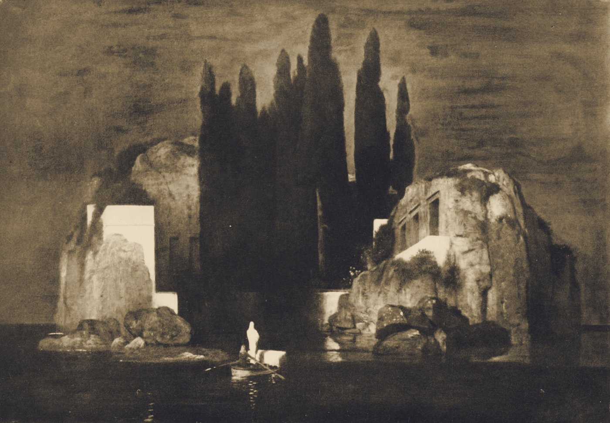

# PhotoCraft demos

[All apps](README.md) | [Repo README](../../README.md)

**What it is**: raster editing with layers, masks, filters, adjustment stacks and batch export.
The app's own comparison is Adobe Photoshop. Driven by
`C:\Program Files\PhotoCraft\photocraft-cli.exe` (verified against 0.12.0).

PhotoCraft carries the most demos because it is the clearest place to show a *non-destructive*
stack, a batch action, a live drawing, and an honest model benchmark in one app.

## Demos

| Demo | What actually runs | Artifacts | AI step |
|---|---|---|---|
| `plate-grade` | A real public-domain plate (Boecklin, 1880) through Black & White, Curves and Gradient Map adjustment layers, saved with the layer tree intact, then flattened. | `.pcraft`, flattened PNG/JPG, `brief.md` | a three-line restoration note |
| `batch-treatment` | One recorded action (Black & White, Curves, Gaussian grain) applied to three 2024 AI plates, re-encoded as JPEG. | three JPEGs | none - deterministic |
| `lighthouse-live` | Nine stroke stages on a blank 1200x800 canvas: sea, tower, bands, gallery, lantern, beam, rocks, waves, rain. Every stage saves and exports a frame, so playback *is* the drawing. | `.pcraft` per stage, frame PNGs | none |
| `pelican-photo` | Simon Willison's deliberately awkward prompt (a pelican on a bicycle), rendered through convert/info. The ugliness is the measurement. | rendered PNG | the model draws the SVG |
| `capability-map` | The installed CLI's `commands` output (or `--help`). | `capabilities.txt` | none |

`plate-grade` and `lighthouse-live` are flagged **live** - watch the layer stack or the strokes
appear stage by stage.

## Hands-in / Hands-out

| Direction | What |
|---|---|
| Hands-in | a source plate, a recorded action, or a drawing prompt |
| Hands-out | `.pcraft` with the layer tree, flattened PNG/JPG, per-stage frames |



*The 1880 plate after Black & White, Curves and Gradient Map. The `.pcraft` keeps the three
adjustment layers; the JPEG is the flattened result.*


*The lighthouse demo after its nine stages. Each frame is a saved stage, not a fake progress
bar.*


*The pelican benchmark through PhotoCraft. Kept as evidence of what the model can and cannot
draw, not as a showcase.*

## Run it

```
/craft/photo
/craft/photo?demo=lighthouse-live&watch=1
craft(operation="run_demo", app="photo", demo="plate-grade")
```

Artifacts: `outbox/photo/<demo>/`.

## Observed gaps

- No generative fill - PhotoCraft is an editor, not a generator.
- No cloud asset sync.

## Release 0.12.0 notes

PhotoCraft 0.12.0 added:
- Mixer Brush commands (`brush.mixer.load`, `brush.mixer.clean`) for painterly color mixing.
- History Brush state commands (`history.setSource`, `history.stepBackward`, `history.stepForward`, `history.clear`) for selective history restoration across layers.
- Smart-filter architecture for non-destructive filter stacks.
- Content-Aware Move live preview.
