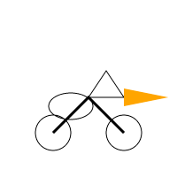

# VectorCraft demos

[All apps](README.md) | [Repo README](../../README.md)

**What it is**: vector paths, compound shapes, gradient presets, text, bundled artwork-cleanup
and path-tool add-ons, SVG/PDF export. The app's own comparison is Adobe Illustrator. Driven by
`C:\Program Files\VectorCraft\vectorcraft-cli.exe` (verified against 0.19.0, 2026-11-01).

## Demos

| Demo | What actually runs | Artifacts | AI step |
|---|---|---|---|
| `pelican-vector` | Simon Willison's awkward prompt (a pelican on a bicycle), rendered through the run/export pipeline. | exported vector artifact, PNG preview | the model draws the SVG |
| `cleanup-pass` | Artwork Cleanup's health check, then fix-all, select-all and keep-shape simplify (tolerance 20, corners protected), then a second check. Input: a traced sample (dense polylines plus six planted defects), the VectorCraft icon from the upstream repo, or an SVG path you type. Both renders are diffed pixel by pixel. | `input.svg`, `cleaned.svg`, `before.png`, `after.png`, `diff.png` (x8), `cleanup-report.md/.json` | none |
| `capability-map` | The installed CLI's `commands` output (or `--help`). | `capabilities.txt` | none |

Measured on 0.19.0. Traced sample: 16 issues to 0, 1,030 anchors to 493 (-52%), 17.4 KB to
7.3 KB, 0.34% of pixels changed. The check flagged three of the six planted defects
(zero opacity, off artboard, duplicate anchor); the duplicate object, the one-anchor path and
the unpainted path were not flagged, most likely dropped by the SVG importer on open. The
report says so per run. VectorCraft app icon (708 KB, a real engraving-style drawing): 20,599
anchors to 12,065 (-41%), 708 KB to 493 KB, renders visually identical.

The point of running the same prompt through PhotoCraft and VectorCraft is the pipeline, not
the bird: one renders raster, one keeps vectors, and the model's drawing is equally suspect in
both. Compare the two images side by side rather than reading a score.

## Hands-in / Hands-out

| Direction | What |
|---|---|
| Hands-in | a drawing prompt |
| Hands-out | vector export (SVG/PDF) and a raster preview |



*The pelican benchmark through VectorCraft. Same prompt as the PhotoCraft page; different
renderer.*

## Run it

```
/craft/vector
/craft/vector?demo=pelican-vector&watch=1
craft(operation="run_demo", app="vector", demo="pelican-vector")
```

Artifacts: `outbox/vector/pelican-vector/`.

## Observed gaps

- Bundled add-ons only (Artwork Cleanup, Path Precision Tools); no third-party plugins.
- Some planted defects never reach the health check because the SVG importer drops them.

## Release 0.19.0 notes (Oct 31 build)

63 new verbs, additive only. Most useful headless: `addon.cleanup.*` (check, fix, simplify,
rejoin, split/combine text, replace fonts), `addon.pathtools.*` (equalize handles, smooth,
simplify corners, crossings), `object.compoundShape.*` (Pathfinder shape modes, so boolean path
operations now exist), `gradient.presets.*`, `object.hide/lock.unselected`.

## Release 0.14.0 notes

VectorCraft 0.14.0 added 7 new verbs:
- `object.objectsOnPath.attach`: Attaches and distributes objects along arbitrary paths, following curve orientations.
- `object.objectsOnPath.expand` & `object.objectsOnPath.options`: Configuration and baking of path-attached groups.
- `select.color`: Global selection by fill and/or stroke hex color (`#rrggbb`).
- `path.moveAnchor`: Precise programmatic repositioning of path anchor coordinates.
- `edit.clearHistory` & `library.moveGroup`.
